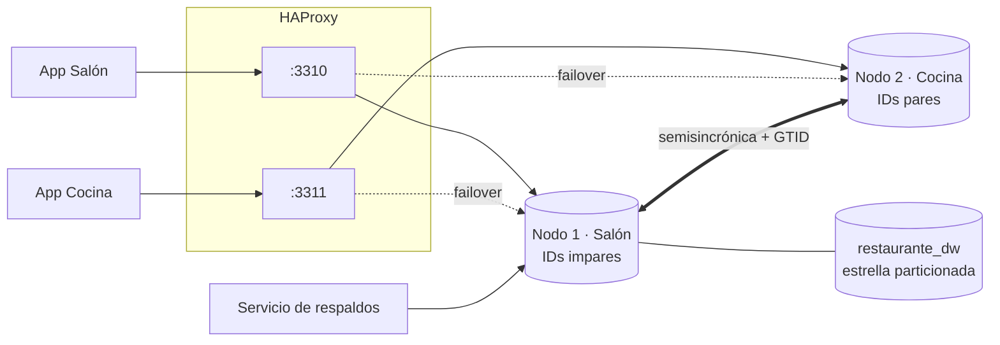

# Base de datos distribuida para la gestión de un restaurante

Trabajo Integrador Final (AE4 - TIFAS) de **Gestión Avanzada de Bases de Datos**, Ingeniería en Sistemas de Información (UCP).

Clúster **MySQL 8.0** multiprimario de dos nodos sobre Docker, que distribuye la operación de un restaurante entre el **Salón/Caja** (Nodo 1) y la **Cocina/Stock** (Nodo 2):

- **Replicación** semisincrónica bidireccional con GTID.
- **Fragmentación de claves:** IDs impares en el Salón y pares en la Cocina.
- **Failover automático** con HAProxy.
- **Respaldos** completos, diferenciales e incrementales con recuperación a un punto en el tiempo.
- **Data warehouse** en estrella con tablas particionadas, vista materializada, minería de datos y tablero.



## Requisitos

- Docker Desktop.
- Git Bash (Windows) o bash (Linux/macOS) para las pruebas.

No hace falta instalar un cliente MySQL: todo se ejecuta con `docker exec`.

## Puesta en marcha y pruebas

```bash
cd restaurant-cluster

# Clúster limpio + datos de los scripts de ABM + verificación de consistencia
bash pruebas_fase2/reiniciar_entorno.sh --si

# Fase 1: ABM repartido entre los dos nodos y restricciones de integridad
bash pruebas_fase1/prueba_flujo_cruzado.sh
bash pruebas_fase1/prueba_restricciones.sh

# Fase 2: caída y failover, switchover, partición de red, desastre lógico y PITR, reconstrucción de un nodo
bash pruebas_fase2/prueba_failover.sh
bash pruebas_fase2/switchover.sh prueba
bash pruebas_fase2/prueba_particion.sh
bash pruebas_fase2/prueba_backup_restore.sh
bash pruebas_fase2/reconstruir_nodo.sh nodo2 --simular-perdida

# Fase 3: carga masiva, EXPLAIN, índices, particionamiento, vista materializada, KDD y tablero (~10 min)
bash pruebas_fase3/ejecutar_fase3.sh --desde-cero
```

Cada prueba guarda su salida completa en la carpeta `resultados/` de su fase. El tablero queda en `restaurant-cluster/fase3/tablero/tablero.html` y se abre con doble clic.

## Mapa del repositorio

| Fase | Contenido | Documentación |
| :--- | :--- | :--- |
| 1. Arquitectura distribuida y ABM | `nodo1/`, `nodo2/` (configuración, esquema, semillas y scripts de ABM), `pruebas_fase1/` | [Modelado y distribución](restaurant-cluster/docs/MODELADO_Y_DISTRIBUCION_AE4.md) · [Evidencia de pruebas distribuidas](restaurant-cluster/docs/EVIDENCIA_PRUEBAS_DISTRIBUIDAS.md) |
| 2. Resiliencia y respaldos | `haproxy/`, `backup/`, `pruebas_fase2/` | [Resiliencia, failover y respaldos](restaurant-cluster/docs/FASE2_RESILIENCIA_Y_BACKUPS.md) |
| 3. Tuning y analítica | `fase3/`, `pruebas_fase3/` | [Tuning, indexación y particionamiento](restaurant-cluster/docs/FASE3_TUNING_INDEXACION_PARTICIONAMIENTO.md) |
| Operación | `docker-compose.yml` | [Guía de despliegue y operación](restaurant-cluster/docs/GUIA_DESPLIEGUE_Y_OPERACION.md) |

| Punto de conexión | Puerto |
| :--- | :--- |
| Nodo 1 (Salón) directo | `3307` |
| Nodo 2 (Cocina) directo | `3308` |
| Salón / Cocina vía HAProxy | `3310` / `3311` |
| Panel de HAProxy | `http://localhost:8404` |
| Instancia de restauración de respaldos | `3309` |

## Equipo

- **Enzo Gabriel (enzogabALF):** infraestructura, nodos y replicación.
- **Jeunex2004:** modelado, DDL y scripts de ABM.
- **Juan Ignacio Benitez Gualtieri:** resiliencia y respaldos (Fase 2), pruebas distribuidas y optimización física y analítica (Fase 3).
