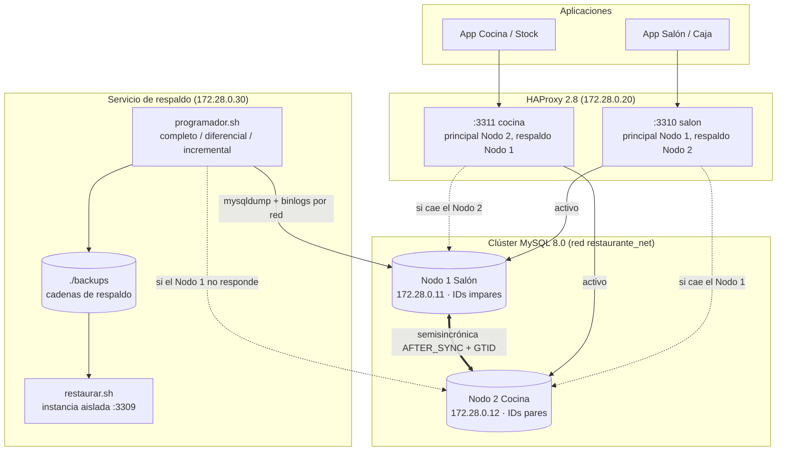

# Fase 2: Resiliencia, Tolerancia a Fallas y Políticas de Respaldo (AE4 - TIFAS)

**Asignatura:** Gestión Avanzada de Bases de Datos
**Caso de estudio:** Sistema Distribuido de Gestión Gastronómica (Salón/Caja y Cocina/Stock)
**Motor:** MySQL 8.0.46 (InnoDB), multiprimario simétrico de 2 nodos con GTID y replicación semisincrónica `AFTER_SYNC`

Este documento cubre los tres requisitos de la Fase 2 de la consigna:

1. **Tolerancia a fallas:** simular caídas de nodos y verificar la conmutación por error automática y manual (*failover* y *switchover*), además de la resincronización de réplicas (secciones 2 y 5).
2. **Recuperación del motor:** el comportamiento de InnoDB ante una caída abrupta, con WAL, checkpoints y Undo/Redo, mostrado con el registro real del servidor (sección 3).
3. **Política de copias de seguridad:** respaldos completos, diferenciales e incrementales alineados con objetivos de RPO y RTO, con scripts de ejecución y restauración automática (secciones 4 y 5).

---

## 1. Arquitectura de la Fase 2



| Componente | Archivo | Función |
| :--- | :--- | :--- |
| HAProxy | [haproxy/haproxy.cfg](../haproxy/haproxy.cfg) | Punto de entrada por área, chequeo de salud MySQL y failover automático |
| Usuarios de alta disponibilidad | [nodo1/init/05_usuarios_alta_disponibilidad.sql](../nodo1/init/05_usuarios_alta_disponibilidad.sql) (y nodo2) | `haproxy_check`, `backup_user` y usuarios de aplicación cruzados |
| Imagen de respaldo | [backup/Dockerfile](../backup/Dockerfile) | `mysql:8.0.46` + `mysqlbinlog`, que la imagen oficial no incluye |
| Scripts de respaldo | [backup/scripts/](../backup/scripts/) | `backup_full.sh`, `backup_diferencial.sh`, `backup_incremental.sh`, `restaurar.sh`, `programador.sh`, `listar_backups.sh` |
| Pruebas | [pruebas_fase2/](../pruebas_fase2/) | Pruebas reproducibles y verificador de consistencia |
| Evidencia | [pruebas_fase2/resultados/](../pruebas_fase2/resultados/) | Salida completa de cada prueba ejecutada |

---

## 2. Conmutación por error (failover)

### 2.1. Diseño

La replicación ya mantiene **los mismos datos en los dos nodos**, pero eso no alcanza: si la aplicación del Salón apunta directo al Nodo 1 y ese nodo cae, el Salón se detiene aunque el Nodo 2 tenga todo. Hace falta **redirigir a los clientes**. Para eso las aplicaciones se conectan a HAProxy, que conoce a los dos nodos:

- **Un área, un escritor:** cada área escribe en un único nodo a la vez. El Salón usa el Nodo 1 y el Nodo 2 es su respaldo; la Cocina hace lo inverso. Así se respeta la fragmentación funcional del diseño y se evitan escrituras concurrentes sobre la misma fila (ver la prueba de partición, sección 5.3).
- **Chequeo de salud real:** `option mysql-check` hace un *handshake* y un login de MySQL con el usuario `haproxy_check`, que no tiene contraseña ni privilegios. Un chequeo TCP no detectaría un servidor colgado que acepta conexiones pero no responde.
- **Tiempos:** se chequea cada 2 s. Tras el primer fallo, cada 0,5 s (`fastinter`), y el nodo se marca caído tras 3 fallos (`fall 3`). Al caer se cortan sus sesiones (`on-marked-down shutdown-sessions`) para que los clientes reconecten de inmediato contra el respaldo.
- **Failback automático:** cuando el principal vuelve (3 chequeos OK), recibe de nuevo el tráfico y se cortan las sesiones del respaldo (`on-marked-up shutdown-backup-sessions`).
- **Usuarios cruzados:** el entrypoint de Docker crea `app_salon` solo en el Nodo 1 y `app_cocina` solo en el Nodo 2. Para que el failover funcione, ambos usuarios se crean en ambos nodos (script `05_...sql`).

### 2.2. Conmutación automática ante caída (failover)

Ante una caída abrupta el proceso es automático. HAProxy detecta la caída y redirige; la replicación semisincrónica garantiza que el respaldo ya tiene todas las transacciones confirmadas (**RPO = 0**).

Mientras el otro nodo está caído, el primer `COMMIT` espera el acuse de recibo hasta el timeout de 3 s (`rpl_semi_sync_master_timeout`), y después la replicación se **degrada a asíncrona** para no bloquear el servicio. En términos del teorema CAP, durante la falla el sistema elige **disponibilidad** (Brewer, 2012). Cuando el nodo vuelve y se pone al día, la semisincronía se reactiva sola.

### 2.3. Conmutación planificada (switchover)

Para un mantenimiento programado no se "tira" el nodo, sino que se lo saca ordenadamente ([switchover.sh](../pruebas_fase2/switchover.sh)):

1. `SET GLOBAL super_read_only = ON` en el nodo que sale: congela las escrituras. El hilo de réplica no está sujeto a `read_only`, así que sigue recibiendo cambios.
2. `WAIT_FOR_EXECUTED_GTID_SET` en el otro nodo: se espera a que tenga **todas** las transacciones del que sale. Recién entonces es seguro mover el tráfico.
3. API de administración de HAProxy: el nodo pasa a `MAINT` y se cortan sus sesiones.
4. La vuelta hace lo inverso y espera a que el nodo se ponga al día **antes** de devolverle el tráfico.

### 2.4. Reconstrucción de un nodo perdido

Si se pierde el disco de un nodo, **no alcanza con dejar que la replicación lo vuelva a llenar**. En replicación circular, cada servidor descarta los eventos que llevan su propio `server_id` (para que una transacción no gire indefinidamente entre los nodos). El nodo rehecho conserva su `server_id`, así que ignora las transacciones que él mismo había generado antes del desastre y queda **incompleto sin dar error**. Se comprobó en este clúster: el Nodo 2 reconstruido solo por replicación quedó con 11 de 16 comandas.

El procedimiento correcto ([reconstruir_nodo.sh](../pruebas_fase2/reconstruir_nodo.sh)) es:

1. Sacar el nodo de HAProxy, porque no debe atender clientes con datos parciales.
2. Levantarlo vacío y esperar a que termine `init/`.
3. Pausar la lectura del sobreviviente desde este nodo.
4. Con `sql_log_bin = 0`, borrar la base y limpiar el historial GTID.
5. Sembrarlo con un `mysqldump --single-transaction --set-gtid-purged=ON` en caliente del sobreviviente.
6. Reanudar la replicación, verificar la consistencia y devolverlo al servicio.

> **Lección aprendida:** el `sql_log_bin = 0` del paso 4 es obligatorio. En el primer intento se omitió: el `DROP DATABASE` se escribió en el binlog del nodo en reconstrucción, el sobreviviente (que replica *desde* ese nodo) lo recibió y borró su propia base. En un multiprimario, toda tarea de mantenimiento local se hace sin registrarla en el binlog.

---

## 3. Recuperación del motor ante una caída abrupta (WAL, checkpoints y Undo/Redo)

### 3.1. Dos registros con propósitos distintos

| | **Redo log de InnoDB** (WAL) | **Binary log** (binlog) |
| :--- | :--- | :--- |
| Nivel | Físico: cambios a páginas de datos | Lógico: transacciones confirmadas, fila por fila (`ROW`) |
| Propósito | Recuperación local ante caída (*crash recovery*) | Replicación y recuperación a un punto en el tiempo (PITR) |
| Ciclo de vida | Circular: se reutiliza una vez que el checkpoint persistió las páginas | Se conserva por días (`binlog_expire_logs_seconds`, 30 días por defecto) |
| En esta Fase | Recuperación tras el `docker kill` | Incrementales, diferenciales, PITR y resincronización de nodos |

### 3.2. Flujo de escritura (Write-Ahead Logging)

1. La transacción modifica páginas en memoria (*buffer pool*) y guarda la versión anterior de cada fila en el **undo log**.
2. Antes de confirmar, el cambio se escribe en el **redo log** (*write-ahead*: el registro va antes que los datos).
3. Con el binlog activo, MySQL usa una **confirmación en dos fases interna**: *prepare* en InnoDB, escritura en el binlog y *commit* en InnoDB.
4. `innodb_flush_log_at_trx_commit = 1` y `sync_binlog = 1` fuerzan ambos registros al disco en cada `COMMIT`: durabilidad total a cambio de algo de rendimiento.
5. Periódicamente, el **checkpoint** escribe en disco las páginas modificadas y avanza el *checkpoint LSN*. Desde ahí en adelante comienza la recuperación.

### 3.3. Evidencia real: recuperación del Nodo 1 tras el corte de energía

Registro del servidor al reiniciar el Nodo 1 después del `docker kill`, tomado de [prueba_failover](../pruebas_fase2/resultados/prueba_failover_20261113_013828.txt). Se activó `--log-error-verbosity=3` para que estos mensajes de nivel *Note* queden visibles.

```text
[InnoDB] The latest found checkpoint is at lsn = 30176534 in redo log file ./#innodb_redo/#ib_redo9.
[InnoDB] The log sequence number 29860570 in the system tablespace does not match
         the log sequence number 30176534 in the redo log files!
[InnoDB] Starting crash recovery.
[InnoDB] Starting to parse redo log at lsn = 30176367, whereas checkpoint_lsn = 30176534 ...
[InnoDB] Applying a batch of 16 redo log records ...
[Server] Starting XA crash recovery...
[Server] Crash recovery finished in binlog engine. No attempts to commit, rollback or prepare any transactions.
[Server] Crash recovery finished in InnoDB engine. No attempts to commit, rollback or prepare any transactions.
[Server] XA crash recovery finished.
[Server] /usr/sbin/mysqld: ready for connections.
```

Interpretación, paso a paso:

1. **Detección:** InnoDB encuentra el último checkpoint (LSN 30176534) y ve que los archivos de datos están atrasados respecto del redo log (LSN 29860570). Eso indica que el servidor no se apagó ordenadamente.
2. **Redo (*roll-forward*):** reaplica los registros del redo log desde el checkpoint (16 registros). Así recupera los cambios confirmados que estaban en memoria pero no habían llegado a las páginas en disco.
3. **Undo (*rollback*):** las transacciones que no llegaron a confirmarse se deshacen con el undo log. En esta prueba no había ninguna en curso al momento del corte, por eso dice "No attempts to ... rollback".
4. **Coordinación con el binlog (XA):** las transacciones que hubieran quedado en estado *prepared* se confirman si figuran en el binlog y se deshacen si no. Así lo que se replicó al otro nodo coincide siempre con lo que quedó en la base.

Es el esquema Undo/Redo del algoritmo ARIES (Mohan et al., 1992), descripto en la sección 5.3 del informe, observado en un caso real.

---

## 4. Política de copias de seguridad

### 4.1. Por qué hacen falta respaldos si ya hay replicación

La replicación protege contra la **caída de un servidor**, pero no contra un **error**. Un `DELETE` accidental, un `UPDATE` sin `WHERE` o un ataque de *ransomware* se replican al otro nodo en milisegundos. La prueba 4 (sección 5.4) lo demuestra: un `DELETE FROM pagos` en el Nodo 1 dejó **ambos** nodos sin pagos. Contra eso solo protege un respaldo con historia.

### 4.2. Objetivos de negocio: RPO y RTO

- **RPO** (*Recovery Point Objective*): cuántos datos, medidos en tiempo, puede tolerar perder el negocio.
- **RTO** (*Recovery Time Objective*): cuánto tiempo puede estar sin servicio.

En un restaurante, perder un cobro es un problema fiscal y contable, y quedarse sin sistema en pleno servicio paraliza el salón y la cocina. Por eso los objetivos son estrictos para las fallas frecuentes y razonables para las catastróficas:

| Escenario de falla | Mecanismo | RPO objetivo | RTO objetivo | **Medido** |
| :--- | :--- | :--- | :--- | :--- |
| Caída de un nodo (corte de luz, cuelgue) | Semisincrónica `AFTER_SYNC` + failover de HAProxy | 0 | < 15 s | **RPO 0 · 8,6 s** |
| Mantenimiento planificado | Switchover verificado por GTID | 0 | < 5 s | **RPO 0 · 1,7 s** |
| Partición de red entre nodos | Cada área sigue en su nodo, reconciliación GTID | 0 | 0 (sin corte) | **0 · reconcilia en 3,7 s** |
| Pérdida del disco de un nodo | Siembra desde el sobreviviente + replicación | 0 | < 5 min | **RPO 0 · 54 s** |
| Error lógico o corrupción (se replica a ambos nodos) | Respaldos + recuperación a un punto en el tiempo | ≤ 15 min | < 30 min | **0 pérdida · restauración en 5,7 s** |
| Pérdida de ambos nodos (incendio, robo) | Respaldos fuera del sitio (ver 6.4) | ≤ 15 min | < 2 h | — |

> El RTO medido para el error lógico (5,7 s) corresponde al volumen de datos de la demostración. El objetivo de 30 minutos incluye el tiempo humano de diagnóstico (identificar la transacción dañina) y el crecimiento de la base.

### 4.3. Tipos de respaldo

| Tipo | Herramienta | Frecuencia | Contenido | Retención |
| :--- | :--- | :--- | :--- | :--- |
| **Completo** | `mysqldump --single-transaction` | Diario (`FULL_CADA_MIN=1440`) | Toda `restaurante_db`: esquema, datos, triggers, rutinas y eventos | 7 días |
| **Diferencial** | `mysqlbinlog --read-from-remote-server --raw` | Cada 6 h (`DIFERENCIAL_CADA_MIN=360`) | Todos los binlogs **desde el completo** | Con su cadena |
| **Incremental** | `mysqlbinlog --read-from-remote-server --raw` | Cada 15 min (`INCREMENTAL_CADA_MIN=15`) | Los binlogs **desde el último respaldo** (de cualquier tipo) | Con su cadena |

- **Completo consistente sin bloquear el servicio:** `--single-transaction` lee todo dentro de una transacción `REPEATABLE READ`, es decir, una foto MVCC de InnoDB, así que los mozos y la cocina siguen trabajando durante el respaldo. `--source-data=2` anota la posición del binlog de esa foto, `--flush-logs` rota el binlog en ese instante y `--set-gtid-purged=ON` guarda los GTID incluidos. Así se sabe exactamente desde dónde reaplicar.
- **Diferenciales e incrementales con binlogs:** el binlog en formato `ROW` contiene cada cambio confirmado, fila por fila. Copiarlo es un respaldo incremental natural y, además, permite **recuperar a un punto en el tiempo (PITR)** (Oracle Corporation, s.f.-d).
- **Restauración con diferenciales:** alcanza con `completo + último diferencial + incrementales posteriores`, en lugar de todos los incrementales. Eso acorta el RTO y reduce el riesgo de que un incremental dañado rompa la cadena.
- **Integridad:** cada pieza guarda su checksum SHA-256, que se verifica antes de restaurar. La restauración también controla que no falte ningún binlog de la secuencia.
- **Retención:** se borran cadenas enteras de más de 7 días, nunca piezas sueltas, porque solas no sirven.
- **Respaldo lógico, no físico:** se eligió `mysqldump` porque la base es chica, el archivo es legible y portable entre versiones, y no requiere herramientas externas. Si la base creciera a decenas de GB, convendría un respaldo físico con incrementales a nivel de página (Percona XtraBackup o MySQL Enterprise Backup), porque restaurar un dump lógico grande es lento.

### 4.4. Estructura en disco

```text
backups/                              (fuera de git)
├── cadena_actual                     nombre de la cadena en uso
├── backup.log                        bitácora de todas las ejecuciones
└── cadenas/
    └── 20261113_012911_nodo1/        una CADENA = 1 completo + sus binlogs
        ├── full/        dump.sql.gz  meta.env  SHA256SUMS
        ├── incremental_20261113_012912/   mysql-bin.000011  meta.env  SHA256SUMS
        ├── diferencial_20261113_012913/   mysql-bin.000011  mysql-bin.000012  ...
        ├── incremental_20261113_012916/   mysql-bin.000013  ...
        └── estado.env                     último binlog copiado
```

Una cadena está atada al nodo que hizo el completo, porque los archivos de binlog son propios de cada servidor. **Tolerancia a fallas del propio respaldo:** si el nodo origen de la cadena está caído, el programador no puede seguirla. Entonces inicia una cadena nueva con un completo desde el otro nodo, que tiene todos los datos gracias a la replicación completa. Esto fue probado: con el Nodo 1 detenido, el programador creó la cadena `..._nodo2` y siguió con incrementales desde el Nodo 2.

### 4.5. Restauración automática y verificada

`restaurar.sh` **nunca toca los nodos productivos**. Restaura sobre una instancia MySQL aislada (puerto 3309) y:

1. Verifica los checksums del completo y de cada binlog.
2. Elige las piezas (último diferencial más los incrementales posteriores) y controla la continuidad de la secuencia.
3. Crea una instancia vacía y carga el completo.
4. Reaplica los binlogs con `mysqlbinlog` (*roll-forward*), en una sola invocación como recomienda el manual. Opcionalmente lo hace **hasta un instante** (`--hasta`) o **excluyendo transacciones** (`--excluir-gtids`).
5. Compara la cantidad de filas por tabla con producción y mide el tiempo total (RTO).

La instancia queda levantada para inspección. Si los datos recuperados son correctos, se reinyectan en producción (como en la prueba 4) o se usan para reconstruir un nodo.

---

## 5. Pruebas y resultados medidos

Todas las pruebas son **reproducibles en cualquier máquina** con Docker Desktop. Se ejecutan desde `restaurant-cluster/` con Git Bash (Windows) o bash (Linux/macOS), y no necesitan un cliente MySQL instalado. Cada una guarda su salida completa en `pruebas_fase2/resultados/`.

```bash
cd restaurant-cluster
bash pruebas_fase2/reiniciar_entorno.sh            # entorno limpio + datos de ABM + verificación
bash pruebas_fase2/prueba_failover.sh              # 1. caída abrupta y failover automático
bash pruebas_fase2/switchover.sh prueba            # 2. switchover planificado
bash pruebas_fase2/prueba_particion.sh             # 3. partición de red (CAP)
bash pruebas_fase2/prueba_backup_restore.sh        # 4. desastre lógico y PITR
bash pruebas_fase2/reconstruir_nodo.sh nodo2 --simular-perdida   # 5. pérdida del disco de un nodo
bash pruebas_fase2/verificar_consistencia.sh       # verificador (en cualquier momento)
```

### 5.0. Verificador de consistencia

[verificar_consistencia.sh](../pruebas_fase2/verificar_consistencia.sh) comprueba tres cosas:

- que los hilos de replicación de ambos nodos estén corriendo;
- la convergencia de GTID (cada nodo aplicó todo lo del otro);
- una **huella digital por tabla**: cantidad de filas más el XOR de un SHA-256 por fila, sobre **todas** las columnas.

Todas las pruebas lo ejecutan al final.

### 5.1. Prueba 1: caída abrupta del Nodo 1 y failover automático

Resultado: [prueba_failover_20261113_013828.txt](../pruebas_fase2/resultados/prueba_failover_20261113_013828.txt)

| Paso | Resultado |
| :--- | :--- |
| Se confirma una comanda en el Nodo 1 y se lo mata con `docker kill` (SIGKILL) | — |
| HAProxy redirige el Salón al Nodo 2 | **8,6 s** después de la caída |
| ¿La comanda confirmada sobrevivió? | Sí: **RPO = 0** |
| 1.ª escritura con el Nodo 1 caído | 3,3 s (espera el timeout semisincrónico) |
| Escrituras siguientes | 0,2 s (replicación degradada a asíncrona, `Rpl_semi_sync_master_status = OFF`) |
| El Nodo 1 vuelve | Crash recovery con redo (sección 3.3), healthy en ~11 s |
| Resincronización por GTID y failback | < 1 s; la semisincronía vuelve a `ON` |
| Consistencia final | 8/8 tablas idénticas |

### 5.2. Prueba 2: switchover planificado

Resultado: [prueba_switchover_20261113_013624.txt](../pruebas_fase2/resultados/prueba_switchover_20261113_013624.txt)

- **Corte de escrituras del Salón:** 1,7 s, con RPO = 0 verificado por GTID antes de mover el tráfico.
- Durante el mantenimiento, el Salón sigue operando contra el Nodo 2. Una escritura directa al Nodo 1 congelado es rechazada con `ERROR 1290 ... --read-only`.
- Tras el reinicio del Nodo 1, el área vuelve a él solo después de que se pone al día.
- Consistencia final: 8/8.

### 5.3. Prueba 3: partición de red (teorema CAP)

Resultado: [prueba_particion_20261113_013654.txt](../pruebas_fase2/resultados/prueba_particion_20261113_013654.txt)

Se simula cortando el enlace de replicación en ambos sentidos (`STOP REPLICA IO_THREAD`), mientras cada área sigue conectada a su nodo.

- **Parte A, disponibilidad:**
  - Ambas áreas siguen escribiendo (primera escritura de 3,2 s por el timeout semisincrónico).
  - Los IDs 15 (impar, Salón) y 16 (par, Cocina) no colisionan.
  - Al reconectar, la replicación GTID reconcilia todo en 3,7 s sin intervención.
- **Parte B, límite del diseño:**
  - Si **las dos áreas modifican la misma fila** durante la partición (mesa 9: el Salón la marca `RESERVADA` y la Cocina `OCUPADA`), al reconectar cada nodo aplica el cambio del otro y los valores quedan **cruzados**.
  - La replicación sigue en `Yes`: MySQL no detecta el conflicto.
  - El verificador **sí lo detecta** (`mesas ... DIFERENTE`), y se repara reescribiendo el valor en el nodo dueño de la tabla.

**Conclusión:** ante una partición el clúster es **AP** (prioriza la disponibilidad). Las altas se reconcilian solas gracias a la fragmentación de claves, y las modificaciones de una misma fila se evitan con la regla "cada tabla tiene un nodo dueño de sus escrituras", que es la fragmentación funcional del diseño.

### 5.4. Prueba 4: desastre lógico y recuperación a un punto en el tiempo

Resultado: [prueba_backup_restore_20261113_013738.txt](../pruebas_fase2/resultados/prueba_backup_restore_20261113_013738.txt)

1. Completo, operación, incremental, operación y diferencial.
2. **Desastre:** `DELETE FROM pagos` en el Nodo 1. Se identifica su GTID con `GTID_SUBTRACT`. **El error se replicó: 0 pagos en ambos nodos.**
3. La operación sigue: se abre una comanda legítima y se toma un incremental.
4. **Restauración:** completo + diferencial + incremental, **excluyendo solo el GTID del `DELETE`**. Tarda 5,7 s y la instancia restaurada tiene los 4 pagos y también la comanda posterior al error.
5. **Reinyección** de los pagos en el Nodo 1 (0,3 s). La replicación los propaga y se recupera el total cobrado exacto ($158.400,00).
6. Consistencia final: 8/8.

Además se verificó la restauración de una cadena *completo + diferencial + incremental* con un cambio posterior al último respaldo. La herramienta lo informa como **pérdida dentro del RPO** ("1 tablas difieren de producción").

### 5.5. Prueba 5: pérdida total del disco de un nodo

Resultado: [reconstruir_nodo2_20261113_014806.txt](../pruebas_fase2/resultados/reconstruir_nodo2_20261113_014806.txt)

- Se borra `nodo2/data` y el nodo se reconstruye con siembra en caliente desde el Nodo 1 (sección 2.4).
- Tiempo total: **54 s**, con **RPO = 0**.
- Incluye las transacciones que había generado el Nodo 2 original, que la replicación sola habría perdido.
- Consistencia final: 8/8.

---

## 6. Problemas encontrados, decisiones y limitaciones

### 6.1. Errores de la Fase 1 corregidos (necesarios para la Fase 2)

Las semillas (`04_seed_catalogos.sql`) se cargan con `sql_log_bin = 0` en cada nodo y producían **datos distintos** en cada uno:

- Mesas, clientes y movimientos de stock sin ID explícito: el Nodo 1 generaba IDs impares y el Nodo 2 pares. La primera comanda creada en Cocina rompía la replicación hacia el Salón (error de FK 1452) y los scripts de ABM fallaban sobre un clúster nuevo.
- `nodo_origen` distinto en las 12 filas de stock inicial.
- Marcas de tiempo (`created_at`, `ultima_actualizacion`, `fecha_movimiento`) del instante de carga de cada nodo.

Corrección: IDs explícitos, `nodo_origen = 'NODO_2_COCINA'` (la Cocina es la dueña del stock) y `SET TIMESTAMP` fijo durante la carga. Ahora ambos nodos arrancan idénticos y el verificador compara todas las columnas.

### 6.2. Detalles del entorno

- **`mysqlbinlog` no viene en la imagen oficial `mysql:8.0`:** se extrae solo ese binario del RPM oficial de la misma versión, porque el paquete cliente completo choca con los archivos de la imagen.
- **`my.cnf` ignorado en Windows:** Docker Desktop monta los archivos de Windows con permisos de escritura para todos, y MySQL ignora por seguridad un archivo de configuración así (*World-writable config file ... is ignored*). No tiene impacto porque `docker-compose.yml` repite toda la configuración en `command:`, pero `my.cnf` no es la fuente efectiva de la configuración.
- **Servidor temporal de init:** el entrypoint ejecuta `init/` en un servidor temporal que ya responde al healthcheck. Los scripts esperan a que la réplica esté corriendo, porque eso solo ocurre en el servidor definitivo.

### 6.3. Limitaciones conocidas y mejoras para producción

| Limitación | Impacto | Mejora propuesta |
| :--- | :--- | :--- |
| HAProxy es una única instancia | Punto único de falla del acceso | Dos HAProxy con IP virtual compartida (keepalived/VRRP) |
| El failback automático no espera explícitamente a que el nodo se ponga al día | Ventana teórica de lectura desactualizada (en las pruebas la resincronización tardó < 1 s) | `agent-check` de HAProxy que informe "listo" solo con `Seconds_Behind_Source = 0`, o failback manual con `switchover.sh volver` |
| Durante la degradación a asíncrona (timeout de 3 s) | Si en esa ventana también cayera el segundo nodo, podrían perderse transacciones | Es el compromiso elegido (disponibilidad); un tercer nodo (Group Replication con quórum) eliminaría la ventana |
| Conflictos sobre la misma fila en una partición | Divergencia silenciosa | Regla de dueño único por tabla y auditoría con `verificar_consistencia.sh` (o Group Replication con certificación de conflictos) |
| Respaldos en el mismo equipo que los nodos | No protegen ante la pérdida del equipo | Regla 3-2-1: copiar `backups/` a otro sitio (almacenamiento de objetos en la nube) |
| Respaldo lógico (`mysqldump`) | Lento con bases grandes | Respaldo físico (Percona XtraBackup) con incrementales por página |

---

## 7. Referencias

- Brewer, E. (2012). CAP twelve years later: How the "rules" have changed. *Computer, 45*(2), 23–29. https://doi.org/10.1109/MC.2012.37
- HAProxy Technologies. (s.f.). *HAProxy 2.8 configuration manual*. https://docs.haproxy.org/2.8/configuration.html
- Kleppmann, M. (2017). *Designing data-intensive applications*. O'Reilly Media.
- Mohan, C., Haderle, D., Lindsay, B., Pirahesh, H., & Schwarz, P. (1992). ARIES: A transaction recovery method supporting fine-granularity locking and partial rollbacks using write-ahead logging. *ACM Transactions on Database Systems, 17*(1), 94–162. https://doi.org/10.1145/128765.128770
- Oracle Corporation. (s.f.-a). *Semisynchronous replication*. MySQL 8.0 Reference Manual. https://dev.mysql.com/doc/refman/8.0/en/replication-semisync.html
- Oracle Corporation. (s.f.-b). *InnoDB recovery*. MySQL 8.0 Reference Manual. https://dev.mysql.com/doc/refman/8.0/en/innodb-recovery.html
- Oracle Corporation. (s.f.-c). *Redo log*. MySQL 8.0 Reference Manual. https://dev.mysql.com/doc/refman/8.0/en/innodb-redo-log.html
- Oracle Corporation. (s.f.-d). *Point-in-time (incremental) recovery*. MySQL 8.0 Reference Manual. https://dev.mysql.com/doc/refman/8.0/en/point-in-time-recovery.html
- Oracle Corporation. (s.f.-e). *mysqldump — A database backup program*. MySQL 8.0 Reference Manual. https://dev.mysql.com/doc/refman/8.0/en/mysqldump.html
- Oracle Corporation. (s.f.-f). *Using mysqlbinlog to back up binary log files*. MySQL 8.0 Reference Manual. https://dev.mysql.com/doc/refman/8.0/en/mysqlbinlog-backup.html
- Silberschatz, A., Korth, H. F., & Sudarshan, S. (2014). *Fundamentos de bases de datos* (6.ª ed.). McGraw-Hill.
