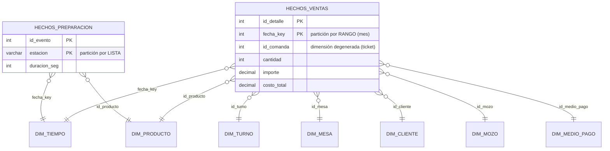

# Fase 3: Ajuste de Rendimiento, Indexación, Particionamiento y Analítica (AE4 - TIFAS)

**Asignatura:** Gestión Avanzada de Bases de Datos
**Caso de estudio:** Sistema Distribuido de Gestión Gastronómica (Salón/Caja y Cocina/Stock)
**Motor:** MySQL 8.0.46 (InnoDB), clúster multiprimario de 2 nodos con replicación semisincrónica

Este documento cubre los tres requisitos de la Fase 3 de la consigna, más los componentes analíticos que la rúbrica menciona para el nivel "Excelente" ("tablero dimensional y algoritmos KDD"):

1. **Diagnóstico con `EXPLAIN`** de reportes con JOINs de varias tablas que sufren table scans (secciones 2 y 3).
2. **Estrategia de indexación** que acelera los reportes sin penalizar la inserción operativa, más el ajuste de estadísticas y la reescritura de consultas (sección 3).
3. **Optimización física:** particionamiento por rango y por lista, y vistas materializadas con refresco periódico (secciones 4 y 5).
4. **Analítica:** data warehouse en estrella cargado desde tres fuentes heterogéneas, cubo OLAP, minería de datos (KDD) y tablero dimensional (secciones 4, 6 y 7).

Todo es reproducible con un solo comando. La salida completa de la ejecución está en [pruebas_fase3/resultados/](../pruebas_fase3/resultados/).

```bash
cd restaurant-cluster
bash pruebas_fase3/ejecutar_fase3.sh --desde-cero
```

---

## 1. Carga masiva

**Script:** [fase3/01_carga_masiva.sql](../fase3/01_carga_masiva.sql)

Para que los cuellos de botella aparezcan, se simula la migración de 22 meses de historial del sistema anterior (enero de 2025 a octubre de 2026):

| Tabla | Filas |
| :--- | ---: |
| clientes | 3.005 |
| comandas | 120.007 |
| detalle_comanda | 310.440 |
| historial_estados_comanda | 470.328 |
| pagos | 115.160 |

La carga tarda **54,7 s** y se replica al Nodo 2 como cualquier otra transacción. Sus decisiones de diseño:

- **Datos deterministas.** Cada valor sale de `CRC32(número de fila)` y no de `RAND()`, así que la carga produce exactamente los mismos datos en cualquier máquina y los resultados son reproducibles.
- **Respeta la fragmentación de claves.** Los IDs son explícitos: impares para lo generado por el Salón y pares para los eventos de la Cocina.
- **Patrones realistas.** El negocio crece un 80 % en el período, hay turnos de almuerzo y cena, clientes frecuentes y ocasionales, y los precios se deflactan un 2,5 % mensual hacia atrás. Además, cada comanda sigue un "perfil" (parrilla, pastas, minuta o picada) que define qué productos se piden juntos: es el patrón que el análisis KDD debe descubrir sin conocerlo.

## 2. Diagnóstico: reportes y planes de ejecución

**Consultas:** [fase3/consultas/](../fase3/consultas/), con una versión original y, cuando corresponde, una `_optimizada`.

| Reporte | Qué responde | Tablas |
| :--- | :--- | :--- |
| R1 | Ventas por mes y categoría del último trimestre | comandas, detalle_comanda, productos_menu |
| R2 | Arqueo de caja de octubre por día, medio de pago y sector | pagos, comandas, mesas |
| R3 | Ranking de mozos: facturación y minutos hasta servir | comandas, historial_estados_comanda |
| R4 | Pedidos de festejo de cumpleaños en todo el historial | detalle_comanda, productos_menu |
| R5 | Cierre de caja de un día | pagos |
| R6 | Diez mejores clientes del año | clientes, comandas |

`EXPLAIN ANALYZE` muestra el plan elegido por el optimizador y el **tiempo real** de cada paso. En el estado inicial aparecen los problemas que pide diagnosticar la consigna:

- **R1:** el optimizador arranca por `productos_menu` y, por cada producto, recorre sus líneas de detalle. En total lee las 310.440 líneas y hace la misma cantidad de búsquedas de su comanda, para quedarse con el 25 % que cae en el trimestre. Es un table scan disfrazado de búsqueda por índice.
- **R2 y R3:** `Table scan on pg` y `Table scan on c`, porque no hay índices sobre las fechas.
- **R4:** `LIKE '%cumpleaños%'` empieza con comodín, así que ningún B+Tree sirve y se lee todo el detalle.
- **R5:** `DATE(fecha_pago) = ...` aplica una función a la columna. Aunque exista un índice, el motor tiene que calcular la función fila por fila (condición no *sargable*).
- **R6:** dos subconsultas correlacionadas se ejecutan una vez por cada uno de los ~3.000 clientes.

## 3. Tuning en tres pasos: estadísticas, índices y reescritura

### 3.1. Resultados

Cada tiempo es el mejor de tres ejecuciones de `EXPLAIN ANALYZE`, con los datos ya en memoria. Las columnas muestran el efecto **acumulado** de cada técnica:

| Reporte | A. Inicial | B. + Estadísticas | C. + Índices | D. + Reescritura | Mejora total |
| :--- | ---: | ---: | ---: | ---: | ---: |
| R1 Ventas por categoría | 828,0 | 200,0 | 138,0 | — | 6,0× |
| R2 Arqueo de caja | 47,9 | 42,2 | 31,4 | — | 1,5× |
| R3 Ranking de mozos | 305,0 | 226,0 | 100,0 | 64,2 (*) | 3,0× |
| R4 Festejos (búsqueda de texto) | 364,0 | 72,4 | 99,4 (**) | 11,4 | 31,9× |
| R5 Cierre del día | 24,7 | 20,4 | 20,1 | 0,2 | 123,5× |
| R6 Mejores clientes | 123,0 | 130,0 | 48,6 | 39,3 | 3,1× |

(*) Con los histogramas creados en el paso C, el optimizador ya elige el plan correcto para R3, y la pista produce exactamente el mismo plan: la diferencia entre 100 y 64 ms es variación entre mediciones. La pista se mantiene como protección (ver 3.4).
(**) `LIKE '%texto%'` no puede usar ningún índice B+Tree: las variaciones entre B y C son ruido de medición. La mejora llega con la reescritura a `MATCH ... AGAINST`.

### 3.2. Estadísticas desactualizadas: el primer cuello de botella

En el clúster recién creado, `information_schema.TABLES` informaba **0 filas** para `productos_menu`, que tiene 12. La tabla se creó vacía y la carga de la semilla no disparó el recálculo automático de estadísticas de InnoDB. Con esa estimación, el optimizador consideraba que empezar por el menú era gratis y elegía el orden de JOIN de R1 descripto en la sección 2.

Un `ANALYZE TABLE` corrige la estimación. **Durante el desarrollo se vio que, sin este paso, los índices nuevos no se usaban:** R1 seguía con el mismo plan aunque el índice existiera. Por eso la estrategia incluye:

- `ANALYZE TABLE` después de cada carga masiva;
- **histogramas** sobre `comandas.estado` y `comandas.fecha_apertura` (`ANALYZE TABLE ... UPDATE HISTOGRAM`), para que el optimizador conozca la distribución real de valores que no están indexados.

### 3.3. Estrategia de indexación

**Script:** [fase3/03_indices.sql](../fase3/03_indices.sql). Las sentencias DDL se replican, así que ambos nodos quedan con los mismos índices.

| Índice | Tipo | Columnas | Reporte | Criterio |
| :--- | :--- | :--- | :--- | :--- |
| I1 `idx_comandas_estado_fecha` | B+Tree compuesto, de cobertura | estado, fecha_apertura, mozo, total | R1, R3 | Primero la igualdad y después el rango; mozo y total evitan leer la fila |
| I2 `idx_comandas_cliente_estado_fecha` | B+Tree de cobertura | id_cliente, estado, fecha_apertura, total | R6 | **Reemplaza** al índice de la FK `fk_comanda_cliente`, que queda redundante |
| I3 `idx_detalle_comanda_cobertura` | B+Tree de cobertura | id_comanda, id_producto, cantidad, subtotal | R1 | Reemplaza al índice de la FK `fk_detalle_comanda`; `subtotal` es una columna generada STORED indexable |
| I4 `idx_pagos_fecha_metodo` | B+Tree de cobertura | fecha_pago, metodo_pago, monto_total | R2, R5 | Rango de fechas de pago |
| I5 `idx_historial_comanda_estado` | B+Tree | id_comanda, estado_nuevo, fecha_cambio | R3 | Reemplaza al índice de la FK `fk_historial_comanda` |
| I6 `ft_detalle_observaciones` | **FULLTEXT** (índice invertido) | observaciones | R4 | Equivalente en MySQL al **GIN** de PostgreSQL: palabra → filas |

**HASH.** InnoDB no permite crear índices hash: `CREATE INDEX ... USING HASH` se convierte en BTREE (el script lo demuestra con `SHOW INDEX`). En su lugar, InnoDB mantiene un **Adaptive Hash Index** automático sobre las páginas B+Tree más consultadas (`innodb_adaptive_hash_index = ON`). Para el tipo de acceso de este sistema, que combina igualdades con rangos y orden, un B+Tree es la estructura adecuada. Un hash solo sirve para igualdades exactas.

**Índices redundantes.** I2, I3 e I5 empiezan por la columna de una clave foránea, así que también sirven a esa FK. Se elimina el índice que InnoDB había creado para cada FK: mantener los dos significaría pagar dos veces el costo de cada inserción.

### 3.4. Reescritura de consultas

| Reporte | Problema | Reescritura |
| :--- | :--- | :--- |
| R3 | Durante el desarrollo, con los índices pero **sin histogramas**, el optimizador sobreestimaba las comandas del trimestre y prefería recorrer las 470.328 entradas del índice del historial (234 ms) | Pista `/*+ JOIN_ORDER(c, h) */`: empezar por las comandas del rango (I1) y buscar solo su evento `LISTA_PARA_SERVIR` (I5). Bajó a 92 ms. En la corrida final, los histogramas ya llevan al optimizador a ese plan; la pista se mantiene para que el plan no dependa de las estadísticas |
| R4 | `LIKE '%texto%'` | `MATCH(observaciones) AGAINST ('cumpleaños' IN BOOLEAN MODE)` sobre el índice FULLTEXT |
| R5 | `DATE(fecha_pago) = '2026-10-15'` (no sargable) | `fecha_pago >= '2026-10-15' AND fecha_pago < '2026-10-16'` (rango sobre la columna) |
| R6 | Dos subconsultas correlacionadas y `YEAR()` | Un solo `JOIN` con `GROUP BY` y el año como rango |

**Cuándo NO conviene el índice invertido.** Durante el desarrollo se probó FULLTEXT para buscar "celíaco" solo en el último mes: fue más lento que `LIKE`. Ese término aparece en el 5 % de las líneas y el filtro de fecha era muy selectivo, así que el optimizador resolvía mejor la consulta recorriendo las pocas comandas del mes. Un índice invertido rinde cuando el término es **poco frecuente** y la búsqueda abarca **todo el historial**, que es el caso de R4: "cumpleaños" aparece en el 1 % de las líneas.

### 3.5. Costo de los índices sobre la inserción

**Script:** [fase3/04_benchmark_insercion.sql](../fase3/04_benchmark_insercion.sql). Se insertan las mismas filas de detalle en tres copias de la tabla que solo difieren en sus índices. Las copias se crean con `sql_log_bin = 0`, sin replicación, para medir únicamente el costo de mantener los índices:

| Variante | Carga masiva (~310.000 filas) | Operación (20.000 INSERT de 1 fila) | Índices secundarios |
| :--- | ---: | ---: | ---: |
| A. Original (PK + índices de las FK) | 6,66 s (21,4 µs/fila) | 1,27 s (63,2 µs/fila) | 10,0 MB |
| B. Fase 3 (índice de cobertura en lugar del de la FK) | 7,21 s (+8,4 %) | 1,34 s (+5,9 %) | 18,1 MB |
| C. Fase 3 + FULLTEXT | 9,56 s (+43,6 %) | 1,33 s (+4,7 %) | 23,6 MB |

**Conclusión:**

- **Índices B+Tree:** encarecen la operación del salón apenas un 5,9 %. El índice de cobertura reemplaza al de la FK en lugar de sumarse.
- **FULLTEXT:** casi no pesa en la operación (ningún costo adicional medible: +4,7 % frente al +5,9 % de B, dentro del margen de variación), pero sí en una carga masiva (+43,6 %), porque reconstruye el índice invertido.

Para futuras migraciones masivas conviene quitar el índice FULLTEXT, cargar los datos y volver a crearlo.

## 4. Data warehouse en estrella y fuentes heterogéneas

### 4.1. Por qué un esquema analítico separado

Los reportes estratégicos agregan cientos de miles de filas, mientras que la toma de comandas necesita respuestas de milisegundos. Mezclar ambas cargas sobre las mismas tablas es la causa típica de los cuellos de botella. Se separan en el esquema `restaurante_dw`, con un **modelo en estrella** (Kimball y Ross, 2013), que se replica igual que el operativo: el Nodo 2 tiene una copia del data warehouse y puede atender el tablero si el Nodo 1 cae.

**Script:** [fase3/05_data_warehouse.sql](../fase3/05_data_warehouse.sql)



- **Granularidad de `hechos_ventas`:** una línea de comanda pagada. Medidas: cantidad, importe y costo, que sale de la planilla de proveedores, de modo que el margen es una medida derivada. `id_comanda` es una *dimensión degenerada*: agrupa las líneas de un ticket y es la base del análisis de canasta.
- **Granularidad de `hechos_preparacion`:** un plato terminado por una estación de cocina, según el log del KDS.

### 4.2. Tres fuentes heterogéneas (ETL)

**Scripts:** [06_generar_log_kds.sql](../fase3/06_generar_log_kds.sql), [07_etl_procedimientos.sql](../fase3/07_etl_procedimientos.sql) y [08_etl_carga.sql](../fase3/08_etl_carga.sql)

| Fuente | Tipo | Formato | Problemas que resuelve el ETL |
| :--- | :--- | :--- | :--- |
| `restaurante_db` | Relacional estructurada | Tablas InnoDB | Carga **incremental** con marca de agua (`fecha_cierre`) y `NOT EXISTS`, idempotente; tolera un día de atraso por replicación |
| [planilla_costos_proveedores.csv](../fase3/fuentes/planilla_costos_proveedores.csv) | Semiestructurada (exportación de Excel) | Windows-1252, separador `;`, coma decimal, punto de miles, fin de línea CRLF | Nombres con espacios y mayúsculas, costo vacío, producto que no está en el menú, fila duplicada y línea vacía |
| Log del KDS (`kds_eventos.log`) | Texto plano desestructurado | Una línea `clave=valor` por evento | Eventos de sistema mezclados (`[SYS]`) y líneas corruptas (`duracion_seg=ERR`) |

El ETL valida antes de convertir. Las vistas `v_costos_validados` y `v_kds_validado` calculan, para cada fila cruda, el valor tipado y un **motivo de rechazo**. Las conversiones (`CAST`, `STR_TO_DATE`) solo se aplican después de validar el formato con `REGEXP`, porque en modo estricto un valor inválido haría fallar todo el `INSERT`. Las filas descartadas quedan en `etl_rechazos` con su motivo, y cada ejecución en `etl_control`.

Resultado de la carga:

| Fuente | Filas leídas | Cargadas | Rechazadas | Motivos de rechazo |
| :--- | ---: | ---: | ---: | :--- |
| Planilla de costos | 267 | 263 | 4 | Línea vacía, costo vacío, producto que no está en el menú, fila duplicada |
| Log del KDS | 50.834 | 50.562 | 272 | 148 líneas con duración inválida (reinicio del KDS) y 124 eventos de sistema |
| Base relacional | — | 297.885 hechos de ventas | 0 | Todas las ventas quedaron con costo (último costo conocido cuando faltaba el del mes) |

Los nombres de producto con espacios sobrantes y en mayúsculas se limpiaron y quedaron asociados a su producto, y los acentos de Windows-1252 llegaron correctamente.

Cuando la planilla no trae el costo de un mes (el flan de febrero de 2026 o el mes en curso), se usa el **último costo conocido** (`LEFT JOIN LATERAL`). Así ninguna venta queda sin costo.

## 5. Optimización física: particionamiento y vista materializada

**Scripts:** [09_vistas_materializadas.sql](../fase3/09_vistas_materializadas.sql), [10_particionamiento.sql](../fase3/10_particionamiento.sql) y [11_demostracion_optimizacion_fisica.sql](../fase3/11_demostracion_optimizacion_fisica.sql)

### 5.1. Particionamiento

| Tabla | Tipo | Clave | Particiones | Para qué |
| :--- | :--- | :--- | :--- | :--- |
| `hechos_ventas` | **RANGE** | `fecha_key` (AAAAMMDD) | Una por mes + `p_futuro` (MAXVALUE) | Los reportes de un período leen solo sus meses; la depuración de meses viejos es un `DROP PARTITION` |
| `hechos_preparacion` | **LIST COLUMNS** | `estacion` | Parrilla, cocina, pastelería y barra | Cada pantalla de estación lee solo su partición |

Restricciones de InnoDB que condicionaron el diseño:

1. **No admite claves foráneas en tablas particionadas.** En un data warehouse es lo habitual: la integridad la garantiza el ETL, que solo inserta claves que existen en las dimensiones.
2. **Toda clave única debe incluir la columna de particionamiento.** Por eso las claves primarias son `(id_detalle, fecha_key)` y `(id_evento, estacion)`.

Mediciones:

| Prueba | Particionada | Sin particionar | Diferencia |
| :--- | ---: | ---: | ---: |
| Ventas de septiembre de 2026 por producto | 7,0 ms (lee 1 de 27 particiones) | 253 ms (lee las 297.885 filas) | 36 veces más rápida |
| Borrar el primer semestre de 2025 (63.243 filas) | 2.661 ms (`DROP PARTITION` de 6 meses) | 6.426 ms (`DELETE` fila por fila) | 2,4 veces más rápida, sin generar undo ni binlog por fila |

`EXPLAIN` muestra la **poda de particiones**: en la columna `partitions` aparece solo `p2026_09` para una consulta de septiembre y solo `p_parrilla` para la pantalla de la parrilla.

**Mantenimiento automático.** El evento mensual `ev_dw_particiones` ejecuta `dw_mantener_particiones(3)`, que divide `p_futuro` (con `REORGANIZE PARTITION`) para que siempre existan las particiones de los próximos tres meses. `p_futuro` es una red de seguridad: si el mantenimiento no corriera, las filas nuevas caen allí en lugar de producir un error.

### 5.2. Vista materializada con refresco periódico

MySQL no tiene `CREATE MATERIALIZED VIEW`. Se implementa con los tres elementos que la definen:

1. **Una tabla con el resultado precalculado:** `mv_ventas_mensuales`, con las ventas por mes, categoría, sector y turno.
2. **Un procedimiento de refresco:** `dw_refrescar_mv_ventas('COMPLETO' | 'INCREMENTAL')`. El modo incremental recalcula solo los meses que recibieron hechos nuevos desde el último refresco (según la columna `cargado_en`) y lo hace dentro de una transacción. Quien lee la vista durante el refresco ve la versión anterior completa, gracias al MVCC de InnoDB.
3. **Una política de refresco periódico:** el evento `ev_dw_actualizacion` ejecuta cada **15 minutos** el ETL incremental y el refresco. Es el mismo RPO de los respaldos de la Fase 2: los datos de gestión pueden tener hasta 15 minutos de atraso, algo aceptable para reportes estratégicos.

| Origen de "ventas de 2026 por mes, categoría y sector" | Tiempo |
| :--- | ---: |
| Base operativa (4 tablas, con los índices de la Fase 3) | 816 ms |
| Esquema en estrella (hechos particionados + dimensiones) | 467 ms |
| Vista materializada `mv_ventas_mensuales` | 0,6 ms |

El refresco completo de la vista tarda 10,9 s y el incremental de un mes, 0,6 s. En la demostración, el evento hizo 3 refrescos automáticos en 12 segundos.

Las tres consultas devuelven el mismo total. La demostración también verifica que:

- una comanda cobrada en el Salón **no** aparece en la vista hasta el siguiente refresco, y sí aparece después;
- el evento programado refresca solo: se lo acelera a cada 5 segundos, se esperan 12 segundos y se cuentan los refrescos que hizo.

**Replicación de eventos.** Al replicarse, MySQL crea el evento en el Nodo 2 con estado `SLAVESIDE_DISABLED`, así que el refresco no corre dos veces y los datos refrescados llegan al Nodo 2 por replicación. Si el Nodo 1 quedara fuera de servicio por mucho tiempo, se habilita el evento en el Nodo 2 con `ALTER EVENT ev_dw_actualizacion ENABLE`.

## 6. Descubrimiento de conocimiento (KDD)

**Script:** [fase3/12_kdd.sql](../fase3/12_kdd.sql). Sigue las etapas del proceso KDD (Fayyad et al., 1996):

1. **Selección:** las tablas de hechos.
2. **Preprocesamiento:** lo resuelve el ETL, con sus rechazos.
3. **Transformación:** la canasta por ticket y las métricas por cliente.
4. **Minería.**
5. **Interpretación.**

Todo dentro del motor, en SQL.

### 6.1. Reglas de asociación (Apriori)

"Quien pide A, también pide B". Para cada regla se calculan tres medidas:

- **Soporte:** proporción de tickets con A y B.
- **Confianza:** proporción de los tickets con A que también tienen B.
- **Lift:** confianza dividida por la proporción de tickets con B. Un lift mayor que 1 indica que se piden juntos más de lo que se esperaría por azar.

Se aplica la propiedad de Apriori (Agrawal y Srikant, 1994): solo se combinan productos que superan el soporte mínimo (2 %), y se conservan las reglas con confianza de al menos 20 %. El análisis procesa 115.160 tickets en 9,6 s.

| Quien pide | también pide | Soporte | Confianza | Lift |
| :--- | :--- | ---: | ---: | ---: |
| Empanada criolla | Cerveza IPA | 15,0 % | 60,4 % | 4,03 |
| Cerveza IPA | Empanada criolla | 15,0 % | 100,0 % | 4,03 |
| Ojo de bife | Vino Malbec | 10,7 % | 70,1 % | 3,33 |
| Bife de chorizo | Vino Malbec | 10,4 % | 69,7 % | 3,31 |
| Sorrentinos | Volcán de chocolate | 13,9 % | 55,5 % | 3,31 |
| Volcán de chocolate | Sorrentinos | 13,9 % | 82,7 % | 3,31 |
| Sorrentinos | Agua mineral | 15,0 % | 60,0 % | 2,83 |

Se encontraron 46 reglas que superan los umbrales.

El algoritmo **descubrió sin conocerlos** los perfiles de consumo con los que se generaron los datos (sección 1). También encontró **asociaciones negativas** (lift < 1): la carne y la gaseosa se piden juntas menos de lo esperable.

**Acción para el negocio:**

- sugerir el Malbec al tomar un pedido de carne;
- armar una promoción de empanadas con cerveza IPA;
- ofrecer el volcán de chocolate a quien pide pastas.

### 6.2. Segmentación de clientes (RFM)

Cada cliente fidelizado recibe un puntaje de 1 a 5 en **R**ecencia (días desde la última visita), **F**recuencia (visitas) y **M**onto (gasto), calculado por quintiles con `NTILE(5)`. Con esos puntajes se lo asigna a un segmento:

| Segmento | Clientes | Recencia promedio | Visitas promedio | Gasto promedio | % de las ventas |
| :--- | ---: | ---: | ---: | ---: | ---: |
| Campeones | 568 | 4 días | 50,6 | $ 2.009.327 | 45,6 % |
| Leales | 503 | 12 días | 28,4 | $ 1.133.451 | 22,8 % |
| En riesgo | 376 | 42 días | 26,9 | $ 1.052.039 | 15,8 % |
| Dormidos | 590 | 111 días | 9,2 | $ 356.210 | 8,4 % |
| Recientes | 232 | 5 días | 12,6 | $ 496.856 | 4,6 % |
| Ocasionales | 144 | 16 días | 12,1 | $ 486.205 | 2,8 % |

El 19 % de los clientes (Campeones) aporta el 45,6 % de las ventas a clientes fidelizados.

**Acción:**

- **Campeones:** programa de beneficios exclusivo.
- **En riesgo:** clientes frecuentes que dejaron de venir; conviene una campaña de reactivación.
- **Recientes:** incentivo para una segunda visita.

### 6.3. Tiempos de cocina (cruce del log del KDS con la base operativa)

| Estación | Almuerzo (12 a 14 h) | Cena 20 h | Pico 21 a 22 h | Cena 23 h | Demora en el pico |
| :--- | ---: | ---: | ---: | ---: | ---: |
| Parrilla | 16,2 min | 15,1 min | 20,2 min | 17,9 min | +24 % |
| Cocina caliente | 12,7 min | 12,0 min | 16,1 min | 13,6 min | +27 % |
| Pastelería | 4,3 min | 4,1 min | 5,6 min | 4,4 min | +33 % |
| Barra | 1,4 min | 1,3 min | 1,8 min | 1,4 min | +35 % |

Hallazgos:

- todas las estaciones se demoran entre un 25 % y un 35 % más en el pico de las 21 a 22 h;
- un bife "cocido" tarda en promedio 22,1 min, contra 15,1 min de uno "jugoso".

**Acción:** reforzar la parrilla en el pico de la cena e informar al cliente el tiempo de espera según el punto de cocción.

## 7. Cubo OLAP y tablero dimensional

**Consultas OLAP:** [fase3/13_cubo_olap.sql](../fase3/13_cubo_olap.sql)

| Operación | Ejemplo | Implementación |
| :--- | :--- | :--- |
| Roll-up | Año, trimestre y categoría, con subtotales y total general | `GROUP BY ... WITH ROLLUP` y `GROUPING()` |
| Slice y dice | 2026, por sector y turno | Filtros sobre las dimensiones |
| Pivot | Medios de pago en columnas | `SUM(IF(...))` |
| Drill-down | Del año a los meses, con variación interanual | Ventana `LAG(..., 12)` |

**Tablero:** [fase3/tablero/tablero.html](../fase3/tablero/tablero.html), que se abre con doble clic sin servidor ni internet. Lo genera [pruebas_fase3/generar_tablero.sh](../pruebas_fase3/generar_tablero.sh) a partir de un documento JSON producido por [fase3/14_tablero_datos.sql](../fase3/14_tablero_datos.sql). Lee **solo** la vista materializada y el esquema en estrella, nunca la base operativa, y contiene:

- indicadores de facturación, tickets, ticket promedio y margen, comparados con el año anterior;
- la evolución mensual;
- las ventas por categoría, sector y turno, y el mapa de calor de demanda por día y hora;
- los productos más vendidos, los tiempos de cocina, las reglas de asociación, los segmentos RFM y los medios de pago.

Con `bash pruebas_fase3/generar_tablero.sh nodo2` se arma desde la réplica del Nodo 2.

## 8. Verificación final

La ejecución termina comparando cada tabla del data warehouse en ambos nodos (`CHECKSUM TABLE`) y ejecutando el verificador de consistencia de la Fase 2 sobre la base operativa. Resultado: las 18 tablas del data warehouse y las 8 de la base operativa son **idénticas** en ambos nodos, y los dos eventos (`ev_dw_actualizacion` y `ev_dw_particiones`) figuran como `ENABLED` en el Nodo 1 y `SLAVESIDE_DISABLED` en el Nodo 2. Toda la fase tardó 477 s. La salida completa está en [ejecutar_fase3_20261113_162838.txt](../pruebas_fase3/resultados/ejecutar_fase3_20261113_162838.txt).

## 9. Limitaciones y mejoras

| Limitación | Mejora propuesta |
| :--- | :--- |
| El data warehouse vive en el mismo clúster que la operación | En producción, una réplica dedicada a analítica o un servicio columnar (por ejemplo, ClickHouse o BigQuery) alimentado por captura de cambios |
| Refresco cada 15 minutos | Captura de cambios desde el binary log hacia Kafka para un tablero en tiempo real (ver la sección 6 del informe) |
| Los eventos solo corren en el Nodo 1 | Habilitarlos manualmente en el Nodo 2 tras un failover prolongado, o usar un planificador externo con elección de líder |
| La pista `JOIN_ORDER` fija un plan | Revisarla si cambia mucho la distribución de los datos; los histogramas reducen la necesidad de pistas |
| Las reglas de asociación consideran pares de productos | Extender Apriori a conjuntos de tres o más productos |

## 10. Referencias

- Agrawal, R., & Srikant, R. (1994). Fast algorithms for mining association rules. En *Proceedings of the 20th International Conference on Very Large Data Bases* (pp. 487–499). Morgan Kaufmann.
- Fayyad, U., Piatetsky-Shapiro, G., & Smyth, P. (1996). From data mining to knowledge discovery in databases. *AI Magazine, 17*(3), 37–54. https://doi.org/10.1609/aimag.v17i3.1230
- Kimball, R., & Ross, M. (2013). *The data warehouse toolkit: The definitive guide to dimensional modeling* (3.ª ed.). Wiley.
- Oracle Corporation. (s.f.-g). *Optimizing queries with EXPLAIN*. MySQL 8.0 Reference Manual. https://dev.mysql.com/doc/refman/8.0/en/using-explain.html
- Oracle Corporation. (s.f.-h). *Partitioning*. MySQL 8.0 Reference Manual. https://dev.mysql.com/doc/refman/8.0/en/partitioning.html
- Oracle Corporation. (s.f.-i). *Optimizer statistics (histograms)*. MySQL 8.0 Reference Manual. https://dev.mysql.com/doc/refman/8.0/en/optimizer-statistics.html
- Oracle Corporation. (s.f.-j). *Using the Event Scheduler*. MySQL 8.0 Reference Manual. https://dev.mysql.com/doc/refman/8.0/en/event-scheduler.html
- Silberschatz, A., Korth, H. F., & Sudarshan, S. (2014). *Fundamentos de bases de datos* (6.ª ed.). McGraw-Hill.
