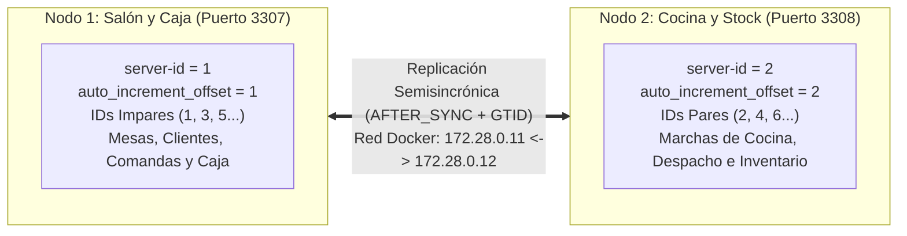

# Guía de Funcionamiento, Despliegue Local y Operación del Clúster

**Proyecto:** Sistema Distribuido de Gestión Gastronómica (AE4 - TIFAS)  
**Motor:** MySQL Server 8.0 (InnoDB)  
**Topología:** Multi-Primary Simétrico (Anillo Bidireccional de 2 Nodos) con Replicación Semisincrónica (`AFTER_SYNC`) y GTID.

---

## 1. ¿Cómo Funciona el Sistema?

El clúster divide la operación del restaurante en dos nodos autónomos que comparten el esquema global `restaurante_db` y se sincronizan en tiempo real:



### Ciclo Operativo de Punta a Punta
1. **Apertura en Salón (Nodo 1 - Puerto `3307`):** El mozo ocupa una mesa en `mesas`, abre una orden en `comandas` (el Nodo 1 le asigna automáticamente un `id_comanda` **impar**: `1, 3, 5...`), registra el evento en `historial_estados_comanda` y carga los platos en `detalle_comanda` con estado `PENDIENTE`.
2. **Consenso Semisincrónico (`AFTER_SYNC`):** Al ejecutar `COMMIT`, el Nodo 1 retiene la confirmación hasta que el evento se escribe en su Binary Log, viaja por la red interna (`172.28.0.0/24`) al Relay Log del **Nodo 2**, se fuerza a disco (`sync_binlog = 1`) y el Nodo 2 responde con el acuse de recibo (`ACK`).
3. **Preparación y Stock en Cocina (Nodo 2 - Puerto `3308`):** El equipo de cocina consulta la comandera en su nodo local y visualiza la comanda creada en el Salón. Al marchar los platos, actualiza la comanda a `EN_PREPARACION`, pasa los ítems culinarios a `EN_COCCION` y descuenta automáticamente el `stock_disponible` en `productos_menu`. Cuando los platos están terminados, cambia el estado a `LISTO` / `LISTA_PARA_SERVIR`.
4. **Cierre y Facturación en Caja (Nodo 1 - Puerto `3307`):** Los cambios realizados por Cocina se replican de regreso al Nodo 1. El cajero liquida la cuenta insertando el comprobante en `pagos`, pasa la comanda a `PAGADA`, suma puntos de fidelización al cliente en `clientes` y libera la mesa (`LIBRE`).

---

## 2. Resumen del Modelo Relacional (`restaurante_db`)

El esquema consta de **8 tablas transaccionales InnoDB** definidas en `01_schema_restaurante.sql`:

| Tabla | Rol Operativo | Nodo Principal de Escritura |
| :--- | :--- | :--- |
| `clientes` | Padrón de clientes para facturación (`cuit_dni` único) y programa de puntos (`puntos_fidelidad`). | Nodo 1 (Salón / Caja) |
| `mesas` | Estado de las mesas del restaurante (`LIBRE`, `OCUPADA`, `RESERVADA`, `CERRANDO_CUENTA`). | Nodo 1 (Salón / Caja) |
| `productos_menu` | Catálogo de platos y bebidas con control de precio y `stock_disponible`. | Ambos (Stock en Nodo 2) |
| `movimientos_stock` | Kardex de inventario (`INGRESO_PROVEEDOR`, `VENTA_COMANDA`, `MERMA_ROTURA`, `AJUSTE_INVENTARIO`). | Nodo 2 (Cocina / Stock) |
| `comandas` | Cabecera de órdenes de consumo vinculada a `mesas` y `clientes`. | Ambos (Impares N1 / Pares N2) |
| `historial_estados_comanda` | Auditoría cronológica de cada cambio de estado de una comanda (`nodo_emisor`, `operador`). | Ambos |
| `detalle_comanda` | Ítems pedidos con columna calculada `subtotal` (`STORED`) y preferencias (`punto_coccion`, `apto_celiaco`, `sin_sal`). | Ambos (Alta en N1 / Marcha en N2) |
| `pagos` | Registro fiscal y cobro de comandas (`metodo_pago`, `tipo_comprobante`, `codigo_autorizacion`). | Nodo 1 (Salón / Caja) |

---

## 3. ¿Cómo Levantar el Proyecto en Local?

### Requisitos Previos
* Tener **Docker Desktop** abierto y en ejecución.
* Cliente MySQL (`mysql.exe`, **MySQL Workbench** o **DBeaver**) para conectarse a los puertos `3307` y `3308`.

### Paso 1: Iniciar o Reiniciar el Clúster desde Cero
Si es la primera vez que levantas el proyecto o si hubo cambios en los scripts de la carpeta `init/`, ejecuta estos comandos en **PowerShell** desde la raíz del repositorio:

```powershell
# 1. Agregar Docker al PATH de la sesión actual (si no está en el PATH global)
$env:PATH += ";C:\Users\Usuario\AppData\Local\Programs\DockerDesktop\resources\bin"

# 2. Detener contenedores previos
docker compose -f "restaurant-cluster/docker-compose.yml" down

# 3. Limpiar directorios de datos persistentes para forzar la ejecución limpia de init/
Remove-Item -Path "restaurant-cluster/nodo1/data/*" -Recurse -Force -ErrorAction SilentlyContinue
Remove-Item -Path "restaurant-cluster/nodo2/data/*" -Recurse -Force -ErrorAction SilentlyContinue

# 4. Levantar ambos nodos en segundo plano
docker compose -f "restaurant-cluster/docker-compose.yml" up -d
```

### Paso 2: Verificar que los Contenedores Estén Saludables (`healthy`)

```powershell
docker ps
```
Debes ver los cuatro contenedores activos:
* `restaurante_nodo1_salon` en `0.0.0.0:3307->3306/tcp`
* `restaurante_nodo2_cocina` en `0.0.0.0:3308->3306/tcp`
* `restaurante_haproxy` en `3310` (Salón), `3311` (Cocina) y `8404` (panel de estado) — Fase 2
* `restaurante_backup` en `3309` (instancia de restauración) — Fase 2

> **Alternativa en un solo paso (Git Bash):** `bash pruebas_fase2/reiniciar_entorno.sh` (desde `restaurant-cluster/`) baja todo, borra los datos, levanta el clúster, carga los scripts de ABM y verifica que ambos nodos queden idénticos. Ver [FASE2_RESILIENCIA_Y_BACKUPS.md](FASE2_RESILIENCIA_Y_BACKUPS.md).

### Parámetros de Conexión para Clientes SQL (Workbench / DBeaver / CLI)

| Parámetro | Nodo 1 (Salón y Caja) | Nodo 2 (Cocina y Stock) |
| :--- | :--- | :--- |
| **Host** | `127.0.0.1` | `127.0.0.1` |
| **Puerto** | `3307` | `3308` |
| **Base de Datos** | `restaurante_db` | `restaurante_db` |
| **Usuario Administrador** | `root` | `root` |
| **Contraseña Root** | `root_password_ae4` | `root_password_ae4` |
| **Usuario de Aplicación** | `app_salon` (`salon_password_ae4`) | `app_cocina` (`cocina_password_ae4`) |
| **Usuario de Replicación** | `repl_user` (`repl_password_ae4`) | `repl_user` (`repl_password_ae4`) |

---

## 4. ¿Cómo Realizar Cada Funcionalidad Implementada?

El proyecto cuenta con cuatro scripts operativos en las carpetas `scripts_abm/` que puedes ejecutar completos por consola o por bloques desde MySQL Workbench.

### A. Protocolo de Verificación Técnica y ABM del Nodo 1
**Archivo:** `restaurant-cluster/nodo1/scripts_abm/verificacion_tecnica_nodo1.sql`

**Cómo ejecutarlo por consola:**
```powershell
& "C:\Program Files\MySQL\MySQL Server 8.0\bin\mysql.exe" -h 127.0.0.1 -P 3307 -u root -proot_password_ae4 --table -e "SOURCE restaurant-cluster/nodo1/scripts_abm/verificacion_tecnica_nodo1.sql"
```

**Funcionalidades que ejecuta paso a paso:**
1. **Bloque 1 (Auditoría de Variables):** Consulta `@@server_id`, `@@auto_increment_increment`, `@@auto_increment_offset`, `@@gtid_mode` y el estado de los plugins `rpl_semi_sync%`.
2. **Bloque 2 (Pruebas de Restricciones `CHECK` y `UNIQUE`):** Incluye sentencias comentadas para probar que el motor rechaza precios negativos (`Error 3819`), cantidades en cero (`Error 3819`) o números de mesa duplicados (`Error 1062`).
3. **Bloque 3 (Alta con IDs Impares):** Abre 3 comandas desde el Salón (generando IDs impares `1, 3, 5`), inserta el registro de auditoría en `historial_estados_comanda` y carga ítems de comida y bebida en `detalle_comanda`.
4. **Bloque 4 (Modificación y Cálculo Atómico):** Calcula el `total` de la comanda sumando la columna generada `subtotal`, pasa la orden a `EN_PREPARACION` y marca las mesas como `OCUPADA`.
5. **Bloque 5 (Baja Lógica):** Cancela la comanda de la Mesa 4 cambiando su estado a `CANCELADA`, registrando el `motivo_cancelacion`, asentando la auditoría en el historial y liberando la mesa.
6. **Bloque 6 (Facturación y Cobro):** Registra el pago mediante `TRANSFERENCIA_QR` y `FACTURA_B` en la tabla `pagos`, pasa la comanda a `PAGADA` y libera la mesa.
7. **Bloque 7 (Evidencia de Resultados):** Consulta todas las tablas y calcula `MOD(id_comanda, 2) AS es_impar` para demostrar que todos los IDs generados en el Nodo 1 son impares.

---

### B. Operaciones Transaccionales Completas de Salón y Caja (Nodo 1)
**Archivo:** `restaurant-cluster/nodo1/scripts_abm/abm_salon.sql`

> **Nota técnica sobre las semillas (`04_seed_catalogos.sql`):** La semilla se ejecuta localmente en cada nodo con `sql_log_bin = 0`, por lo que debe producir datos **idénticos** en ambos. Por eso todos los `INSERT` (`clientes`, `mesas`, `productos_menu` y `movimientos_stock`) usan IDs explícitos (sin ellos, el `auto_increment_offset` generaría IDs impares en un nodo y pares en el otro) y la carga fija el reloj con `SET TIMESTAMP` para que las marcas de tiempo coincidan.

**Cómo ejecutarlo por consola:**
```powershell
& "C:\Program Files\MySQL\MySQL Server 8.0\bin\mysql.exe" -h 127.0.0.1 -P 3307 -u root -proot_password_ae4 --table -e "SOURCE restaurant-cluster/nodo1/scripts_abm/abm_salon.sql"
```

**Funcionalidades incluidas:**
* **Caso 1.A — Apertura transaccional de comanda:** En un bloque `START TRANSACTION ... COMMIT`, ocupa la mesa, inserta la comanda, guarda el evento inicial en `historial_estados_comanda`, agrega platos con preferencias (`punto_coccion = 'A_PUNTO'`, `apto_celiaco`, `sin_sal`) y actualiza el `total`.
* **Caso 1.B — Alta de cliente fidelizado:** Registra un nuevo cliente en `clientes`.
* **Caso 2.A — Adición de plato a comanda abierta:** Agrega un postre (`Volcán de Chocolate`), recalcula el total de la comanda y deja constancia en el historial.
* **Caso 2.B — Reasignación de mozo:** Actualiza el mozo responsable de la comanda y audita el cambio en `historial_estados_comanda`.
* **Caso 3.A — Baja física de ítem (`DELETE`):** Elimina físicamente un plato que aún estaba en estado `PENDIENTE` antes de marchar a cocina y recalcula el total.
* **Caso 3.B — Baja lógica de comanda:** Cancela una comanda abierta por error asignando `estado = 'CANCELADA'` y `motivo_cancelacion`.
* **Sección 4 — Cierre de caja y puntos de fidelidad:** Pasa la comanda a `PAGADA`, emite el comprobante en `pagos` (`TARJETA_CREDITO` / `FACTURA_B`), acredita puntos al cliente (`1 punto por cada $500`) y libera la mesa.
* **Sección 5 — Consultas operativas de Salón:** Estado general de mesas, detalle de pedidos con preferencias culinarias, historial cronológico y arqueo de caja agrupado por medio de pago y tipo de comprobante.

---

### C. Operaciones Transaccionales de Cocina y Control de Stock (Nodo 2)
**Archivo:** `restaurant-cluster/nodo2/scripts_abm/abm_cocina.sql`

**Cómo ejecutarlo por consola (contra el puerto `3308`):**
```powershell
& "C:\Program Files\MySQL\MySQL Server 8.0\bin\mysql.exe" -h 127.0.0.1 -P 3308 -u root -proot_password_ae4 --table -e "SOURCE restaurant-cluster/nodo2/scripts_abm/abm_cocina.sql"
```

**Funcionalidades incluidas:**
* **Caso 1.A — Recepción de mercadería de proveedor (Alta de Stock):** Bloquea el producto con `SELECT ... FOR UPDATE`, registra el remito en `movimientos_stock` (`INGRESO_PROVEEDOR`) con el stock previo y posterior, y suma las unidades en `productos_menu`.
* **Caso 1.B — Apertura de comanda interna en Cocina (ID Par):** Crea una orden de control de calidad desde Cocina (`NODO_2_COCINA`), demostrando que el Nodo 2 genera automáticamente un `id_comanda` **par** (`2, 4, 6...`).
* **Caso 2.A — Marcha de comanda y descuento automático de stock:** Toma la comanda `#1` recibida desde el Salón, cambia su estado a `EN_PREPARACION`, pasa los platos pendientes a `EN_COCCION`, bloquea los productos con `FOR UPDATE`, registra en el Kardex un movimiento `VENTA_COMANDA` por producto (con stock previo y posterior) y descuenta de `productos_menu` las cantidades consumidas.
* **Caso 2.B — Finalización y despacho a Salón:** Actualiza los ítems en cocción a `LISTO`, cambia la comanda a `LISTA_PARA_SERVIR` y registra el aviso de campana en `historial_estados_comanda`.
* **Caso 3.A — Registro de merma o rotura (Baja de Stock):** Bloquea el producto con `FOR UPDATE`, asienta la pérdida en `movimientos_stock` (`MERMA_ROTURA` por pérdida de cadena de frío) y descuenta el inventario disponible.
* **Sección 4 — Consultas de Cocina e Inventario:**
  * **Comandera digital:** Lista en orden de apertura todos los platos en estado `PENDIENTE` o `EN_COCCION` con sus especificaciones (`punto_coccion`, `apto_celiaco`, `sin_sal`).
  * **Semáforo de stock crítico:** Clasifica el inventario activo en `CRÍTICO: REPONER URGENTE` (`<= 15`), `ALERTA: STOCK BAJO` (`<= 30`) o `NORMAL`.
  * **Kardex de movimientos:** Historial completo de entradas, salidas y mermas de mercadería.

---

### D. Protocolo de Verificación Técnica del Nodo 2
**Archivo:** `restaurant-cluster/nodo2/scripts_abm/verificacion_tecnica_nodo2.sql`

**Cómo ejecutarlo por consola (contra el puerto `3308`):**
```powershell
& "C:\Program Files\MySQL\MySQL Server 8.0\bin\mysql.exe" -h 127.0.0.1 -P 3308 -u root -proot_password_ae4 --table -e "SOURCE restaurant-cluster/nodo2/scripts_abm/verificacion_tecnica_nodo2.sql"
```

**Funcionalidades que ejecuta paso a paso:**
1. **Bloque 1:** Variables del Nodo 2 (`server_id = 2`, `offset = 2`, GTID, durabilidad) y un chequeo automático `configuracion_nodo2_ok = 1`.
2. **Bloque 2:** Semisincronía (`rpl_semi_sync%`), `SHOW REPLICA STATUS` del enlace con el Nodo 1 y los GTID ejecutados.
3. **Bloque 3:** Sentencias comentadas de las restricciones de stock (`3819` y `1452`).
4. **Bloque 4:** Un ingreso de mercadería y una comanda interna con historial y detalle, y la comprobación de que las cuatro claves generadas son **pares**.
5. **Bloque 5:** Resumen por tabla y nodo de origen (IDs pares e impares) y el chequeo `violaciones_ids_pares_nodo2 = 0`.

### E. Pruebas Integradas entre Nodos (sin cliente MySQL instalado)
Desde `restaurant-cluster/`, con Git Bash:

```bash
bash pruebas_fase1/prueba_flujo_cruzado.sh   # comanda abierta en el Salón, marchada en Cocina y cobrada en el Salón
bash pruebas_fase1/prueba_restricciones.sh   # 17 violaciones de CHECK / UNIQUE / FOREIGN KEY rechazadas
```

Resultados y análisis en **[EVIDENCIA_PRUEBAS_DISTRIBUIDAS.md](EVIDENCIA_PRUEBAS_DISTRIBUIDAS.md)**.

---

## 5. ¿Cómo Ver y Comprobar los Cambios entre Ambos Nodos?

### 1. Confirmar el Enlace de Replicación (`SHOW SLAVE STATUS`)
Ejecuta en PowerShell para inspeccionar ambos sentidos del anillo:

```powershell
# Estado de replicación en Nodo 1 (escuchando al Nodo 2 - 172.28.0.12)
& "C:\Program Files\MySQL\MySQL Server 8.0\bin\mysql.exe" -h 127.0.0.1 -P 3307 -u root -proot_password_ae4 -e "SHOW SLAVE STATUS\G"

# Estado de replicación en Nodo 2 (escuchando al Nodo 1 - 172.28.0.11)
& "C:\Program Files\MySQL\MySQL Server 8.0\bin\mysql.exe" -h 127.0.0.1 -P 3308 -u root -proot_password_ae4 -e "SHOW SLAVE STATUS\G"
```
**Indicadores clave de éxito:**
* `Slave_IO_Running: Yes`
* `Slave_SQL_Running: Yes`
* `Seconds_Behind_Master: 0`
* `Auto_Position: 1`

### 2. Verificar el Consenso Semisincrónico (`AFTER_SYNC`)
```powershell
& "C:\Program Files\MySQL\MySQL Server 8.0\bin\mysql.exe" -h 127.0.0.1 -P 3307 -u root -proot_password_ae4 --table -e "SHOW STATUS LIKE 'Rpl_semi_sync%';"
```
* `Rpl_semi_sync_master_status = ON` y `Rpl_semi_sync_slave_status = ON`: Indica que el enlace semisincrónico está activo en ambos sentidos.
* `Rpl_semi_sync_master_yes_tx`: Muestra cuántas transacciones fueron confirmadas exitosamente por el otro nodo bajo la regla `AFTER_SYNC`.

### 3. Comparar Datos Replicados en Tiempo Real (Puerto `3307` vs Puerto `3308`)
Para comprobar que cualquier alta o modificación impacta instantáneamente en ambos servidores, ejecuta la misma consulta en ambos puertos:

```powershell
# Consultar comandas, stock e historial en Nodo 1 (Salón - Puerto 3307)
& "C:\Program Files\MySQL\MySQL Server 8.0\bin\mysql.exe" -h 127.0.0.1 -P 3307 -u root -proot_password_ae4 --table -D restaurante_db -e "SELECT id_comanda, id_mesa, mozo, nodo_origen, estado, total FROM comandas; SELECT id_producto, nombre, stock_disponible FROM productos_menu WHERE id_producto IN (3, 8); SELECT id_historial, id_comanda, estado_nuevo, nodo_emisor, observacion FROM historial_estados_comanda;"

# Consultar exactamente lo mismo en Nodo 2 (Cocina - Puerto 3308)
& "C:\Program Files\MySQL\MySQL Server 8.0\bin\mysql.exe" -h 127.0.0.1 -P 3308 -u root -proot_password_ae4 --table -D restaurante_db -e "SELECT id_comanda, id_mesa, mozo, nodo_origen, estado, total FROM comandas; SELECT id_producto, nombre, stock_disponible FROM productos_menu WHERE id_producto IN (3, 8); SELECT id_historial, id_comanda, estado_nuevo, nodo_emisor, observacion FROM historial_estados_comanda;"
```
Verás exactamente los mismos registros en ambos nodos:
* En `comandas`: las órdenes **impares** originadas en `NODO_1_SALON` y las órdenes **pares** originadas en `NODO_2_COCINA`.
* En `productos_menu`: el `stock_disponible` actualizado en ambos nodos tras los ingresos de proveedor, consumos de cocina y mermas.
* En `historial_estados_comanda`: la trazabilidad combinada con eventos emitidos tanto por `NODO_1_SALON` como por `NODO_2_COCINA`.

---

## 6. Fase 2: Resiliencia, Failover y Respaldos

La Fase 2 agrega al clúster un balanceador con conmutación por error automática (HAProxy), un servicio de respaldos automáticos (completo, diferencial e incremental) con restauración verificada, y un conjunto de pruebas reproducibles de caída, switchover, partición de red, desastre lógico y reconstrucción de un nodo.

Toda la documentación, la política de RPO/RTO y los resultados medidos están en **[FASE2_RESILIENCIA_Y_BACKUPS.md](FASE2_RESILIENCIA_Y_BACKUPS.md)**.

| Punto de conexión | Puerto | Uso |
| :--- | :--- | :--- |
| Salón vía HAProxy | `3310` | Aplicación del Salón (va al Nodo 1; si cae, al Nodo 2) |
| Cocina vía HAProxy | `3311` | Aplicación de Cocina (va al Nodo 2; si cae, al Nodo 1) |
| Panel de HAProxy | `8404` | `http://localhost:8404` — estado de cada nodo en vivo |
| Instancia de restauración | `3309` | Base restaurada por `restaurar.sh` (`root` / `root_password_ae4`) |

---

## 7. Fase 3: Tuning, Indexación, Particionamiento, Vistas Materializadas y KDD

La Fase 3 carga 22 meses de historial (120.000 comandas, alrededor de 1 millón de filas), diagnostica los reportes con `EXPLAIN ANALYZE`, aplica la estrategia de índices y reescribe las consultas ineficientes. Además construye un data warehouse en estrella con tablas de hechos particionadas, cargado desde tres fuentes heterogéneas (base relacional, planilla Excel y log de texto del sistema de cocina), con una vista materializada que se refresca cada 15 minutos, análisis KDD y un tablero dimensional.

Toda la fase se ejecuta con un solo comando (unos 10 minutos), que deja la salida completa en `pruebas_fase3/resultados/`:

```bash
cd restaurant-cluster
bash pruebas_fase3/ejecutar_fase3.sh --desde-cero
```

Después, el tablero se abre con doble clic en `fase3/tablero/tablero.html`, y se puede regenerar en cualquier momento con `bash pruebas_fase3/generar_tablero.sh`.

El diseño, las decisiones y los resultados medidos están en **[FASE3_TUNING_INDEXACION_PARTICIONAMIENTO.md](FASE3_TUNING_INDEXACION_PARTICIONAMIENTO.md)**.

| Elemento | Dónde |
| :--- | :--- |
| Data warehouse | Esquema `restaurante_dw` en ambos nodos (se replica) |
| Vista materializada | `restaurante_dw.mv_ventas_mensuales`, refrescada por el evento `ev_dw_actualizacion` |
| Reportes de diagnóstico | `fase3/consultas/` (original y versión optimizada) |
