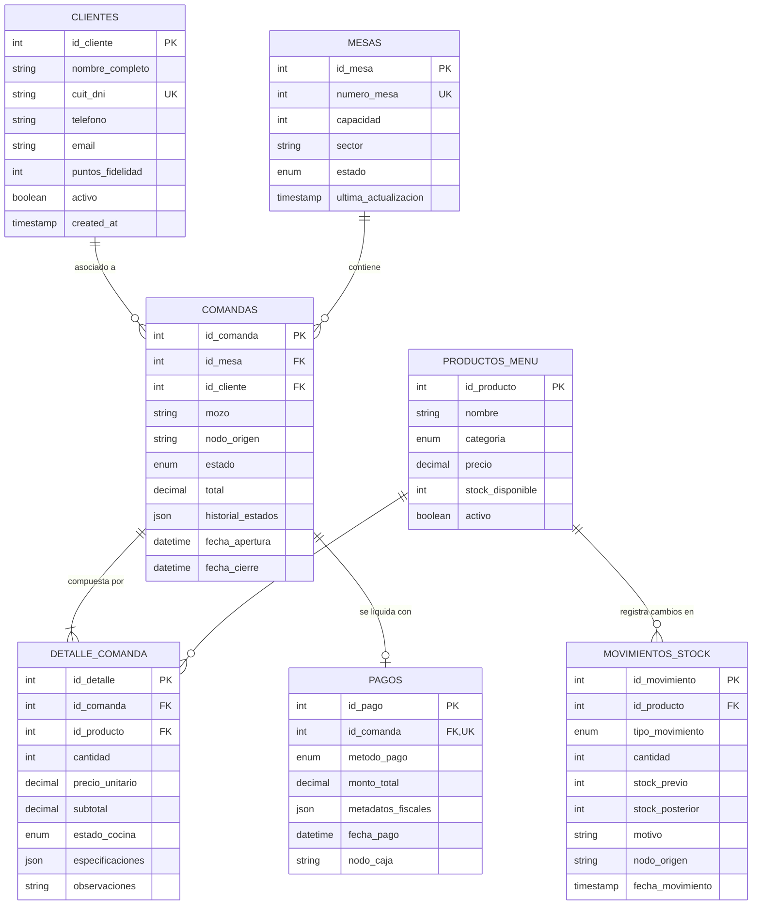

# Modelado Lógico, Fragmentación y ABM Distribuido (AE4 - TIFAS)
**Asignatura**: Gestión Avanzada de Bases de Datos  
**Caso de Estudio**: Sistema Distribuido de Gestión Gastronómica (Restaurante: Salón/Caja y Cocina/Stock)  
**Rol**: Integrante 2 (Modelado, DDL, Fragmentación y ABM)

---

## 1. Descripción del Dominio y Topología Distribuida

El sistema modela la operativa integral de un establecimiento gastronómico de alta rotación, estructurado en dos nodos de procesamiento con autonomía local:

- **Nodo 1 (Salón / Caja)**:
  - Responsabilidad: Gestión de mesas, registro de clientes, toma de comandas por mozos, facturación y cobro.
  - Generación de claves primarias: IDs **impares** (`auto_increment_offset = 1`, `auto_increment_increment = 2`).
- **Nodo 2 (Cocina / Stock)**:
  - Responsabilidad: Recepción de pedidos, gestión de marchas de cocción, recepción de mercadería de proveedores y control de mermas/inventario.
  - Generación de claves primarias: IDs **pares** (`auto_increment_offset = 2`, `auto_increment_increment = 2`).

Ambos nodos se comunican mediante un enlace de replicación semisincrónica con punto de espera `AFTER_SYNC` y registro en formato `ROW` con identificadores globales de transacción (`GTID`).

---

## 2. Diagrama Entidad-Relación (DER)

---

## 3. Criterios de Distribución, Fragmentación y Consistencia

### 3.1. Replicación Total de Catálogos (Autonomía Local de Lectura)
Las tablas `mesas`, `productos_menu` y `clientes` constituyen catálogos maestros compartidos.
- **Justificación**: Tanto el mozo en el salón como el cocinero en la pantalla de despacho necesitan acceder inmediatamente a los nombres de los platos, al estado de las mesas y a las listas de precios sin incurrir en latencia de red entre nodos ni depender de la disponibilidad del otro nodo para consultas de lectura (`SELECT`).

### 3.2. Fragmentación Horizontal Transaccional de Comandas
Las tablas transaccionales (`comandas` y `detalle_comanda`) se fragmentan horizontalmente de forma implícita según su punto de captura (`nodo_origen`):
$$\text{Comandas}_{\text{Salón}} = \sigma_{\text{nodo\_origen} = \text{'NODO\_1\_SALON'}}(\text{Comandas})$$
$$\text{Comandas}_{\text{Cocina}} = \sigma_{\text{nodo\_origen} = \text{'NODO\_2\_COCINA'}}(\text{Comandas})$$

- **Resolución de Colisiones**: La unicidad de la clave primaria en un clúster multi-primary sin coordinador central se garantiza por la función matemática del motor de base de datos:
  $$\text{ID}_{\text{Nodo 1}} = 1 + 2k \quad (1, 3, 5, 7, \dots) \quad \forall k \in \mathbb{N}_0$$
  $$\text{ID}_{\text{Nodo 2}} = 2 + 2k \quad (2, 4, 6, 8, \dots) \quad \forall k \in \mathbb{N}_0$$
  De esta forma, se eliminan los bloqueos distribuidos de generación de identificadores.

### 3.3. Fragmentación Funcional de Dominio
- **Nodo 1 (Salón)** gestiona de forma exclusiva las operaciones de caja (`pagos`). Ningún pago se origina en Cocina, evitando conflictos de concurrencia sobre la caja.
- **Nodo 2 (Cocina)** gestiona de forma predominante la auditoría física de insumos y mermas en `movimientos_stock`.

---

## 4. Preservación de Restricciones de Integridad

| Tipo de Restricción | Implementación en DDL | Propósito Académico |
| :--- | :--- | :--- |
| **Entidad (PK)** | `id_* INT AUTO_INCREMENT PRIMARY KEY` | Unicidad absoluta con aritmética de incremento simétrico. |
| **Unicidad (UK)** | `numero_mesa UNIQUE`, `cuit_dni UNIQUE`, `id_comanda UNIQUE` en pagos | Evita mesas duplicadas y doble facturación de una misma comanda. |
| **Referencial (FK)** | `ON UPDATE CASCADE ON DELETE RESTRICT` | Garantiza que no se puedan eliminar clientes o mesas si poseen comandas históricas activas. |
| **Referencial (Cascade)** | `ON DELETE CASCADE` en `detalle_comanda` | Si se elimina físicamente una comanda abierta por error, sus líneas huérfanas se limpian atómicamente. |
| **Dominio (CHECK)** | `CHECK (precio >= 0)`, `CHECK (cantidad > 0)`, `CHECK (stock_previo >= 0)` | Restricciones declarativas validadas a nivel motor InnoDB, previniendo datos corrompidos. |
| **Columnas Calculadas** | `subtotal GENERATED ALWAYS AS (cantidad * precio_unitario) STORED` | Elimina anomalías de cálculo aritmético manual en importes. |

---

## 5. Integración Relacional + NoSQL (MySQL 8 JSON Nativo)

Para responder al paradigma de bases de datos híbridas sin fragmentar la arquitectura en múltiples motores heterogéneos, se aprovechan las capacidades documentales de MySQL 8:

1. **`comandas.historial_estados` (JSON Array)**:
   - Almacena un documento semiestructurado con la bitácora cronológica de transiciones de estado, operador, timestamp y nodo emisor.
   - Evita la necesidad de tablas satélite de auditoría que ralentizan las escrituras con múltiples inserciones relacionales.
2. **`detalle_comanda.especificaciones` (JSON Object)**:
   - Permite modelar pedidos culinarios dinámicos (puntos de carne, salsas, advertencias de alérgenos como celiaquía o intolerancia a la lactosa) sin requerir esquemas fijos de columnas booleanas no normalizadas.
3. **`pagos.metadatos_fiscales` (JSON Object)**:
   - Aloja datos variables según la pasarela de pago (CAE, número de lote posnet, hash de billetera virtual MercadoPago / QR).

---

## 6. Organización de Scripts Entregables

1. **DDL y Catálogos**:
   - `nodo1/init/01_schema_restaurante.sql`: Creación del esquema global y restricciones para Nodo 1.
   - `nodo2/init/01_schema_restaurante.sql`: Creación del esquema global y restricciones para Nodo 2.
   - `nodo1/init/04_seed_catalogos.sql` & `nodo2/init/04_seed_catalogos.sql`: Carga inicial de datos compartidos.
2. **Scripts de ABM Operativo**:
   - `nodo1/scripts_abm/abm_salon.sql`: Transacciones de apertura, agregación, baja física, cancelación lógica, cobro y consultas NoSQL de Salón.
   - `nodo2/scripts_abm/abm_cocina.sql`: Transacciones de recepción de mercadería, marcha de platos, mermas de inventario y visor de comandera.
3. **Protocolo de Verificación Académica**:
   - `nodo1/scripts_abm/verificacion_tecnica_nodo1.sql`: Script integral de comprobación de variables críticas, colisiones de IDs impares, integridad referencial y emisión de tickets.
